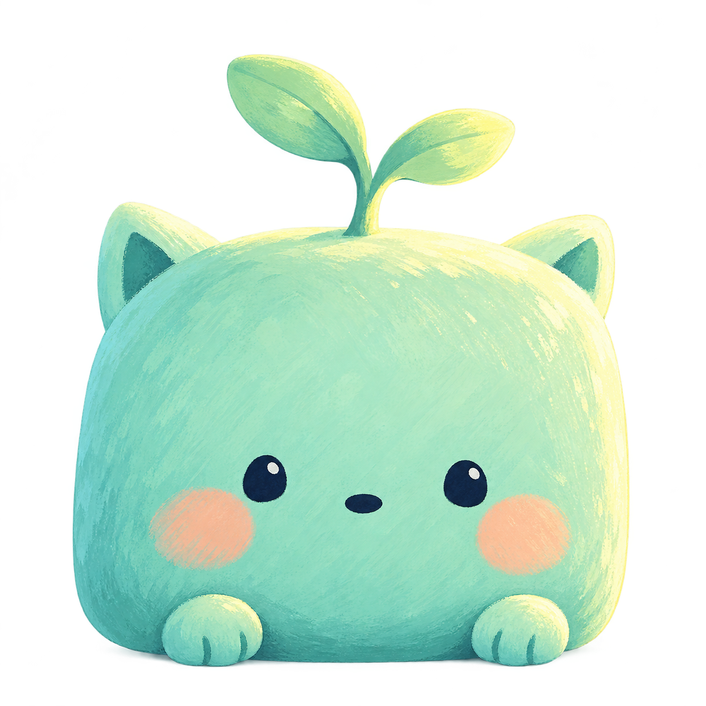
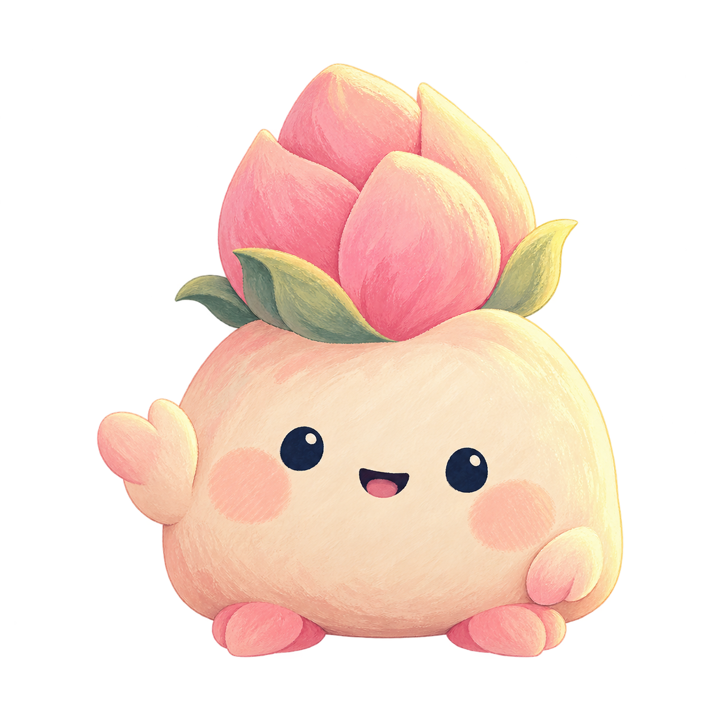
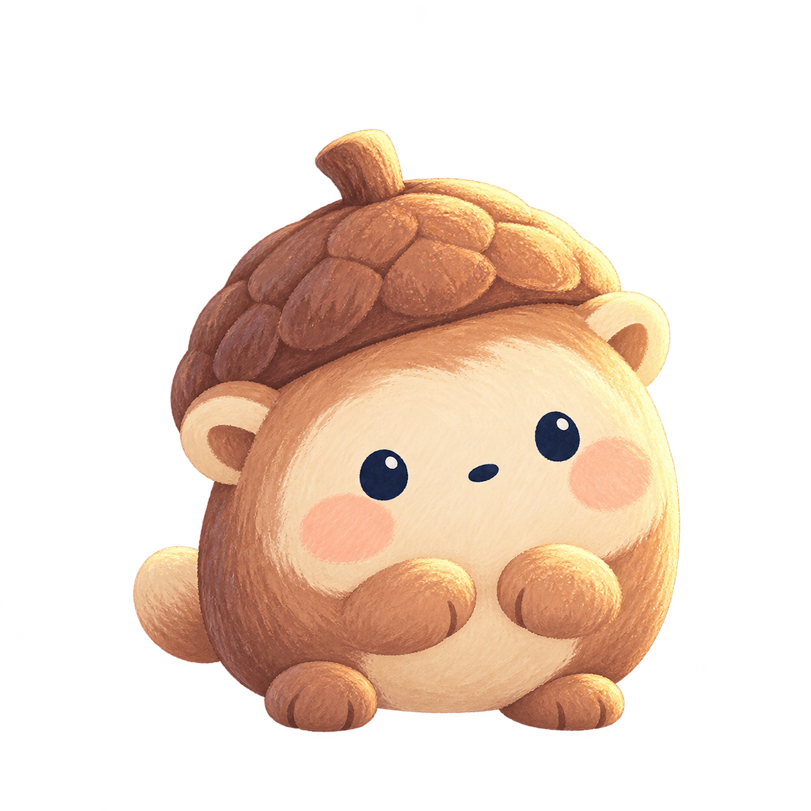
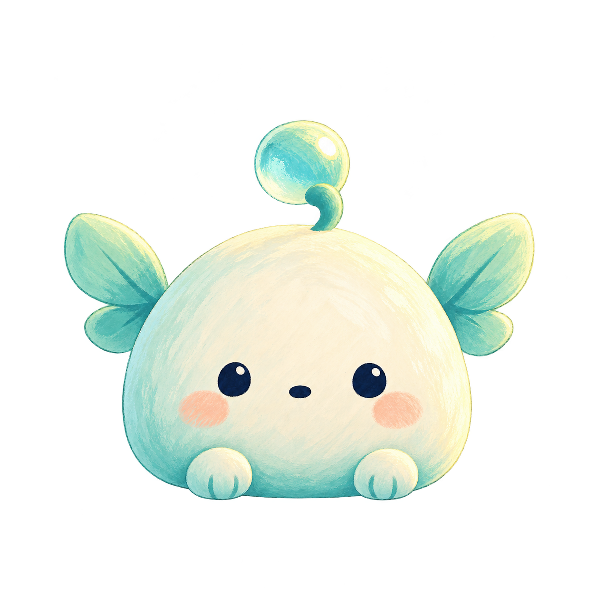
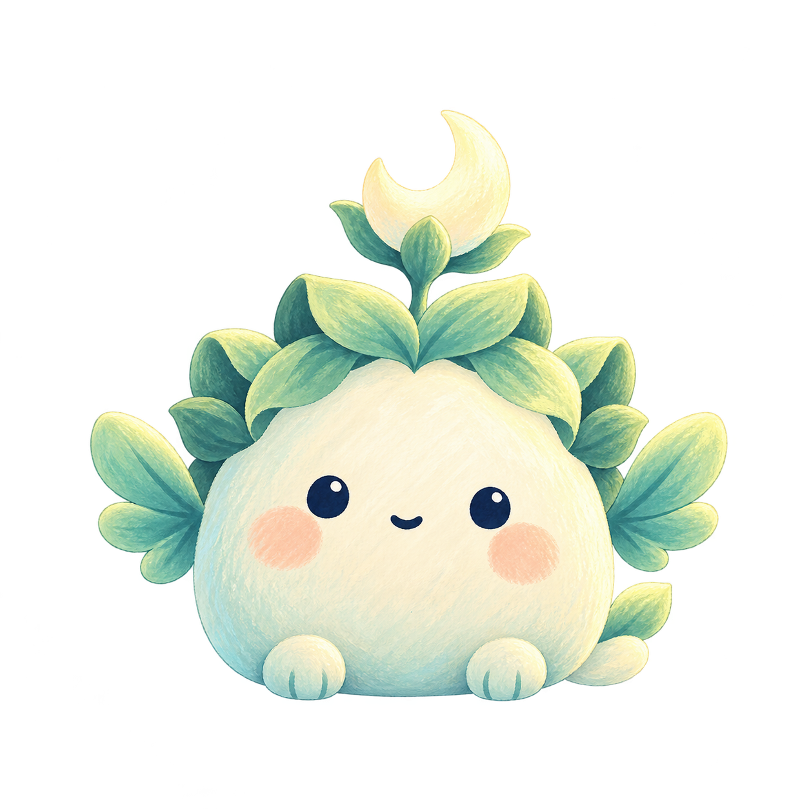

# THE LAST ECHO — 시즌 1 정령 바이블

2026-10-30 · 작가용 설정. **1~5만 실제 공개**하며, 6~25는 아트·획득·이야기 화면이 없는 후속 제작 설계다. 아래 후반 줄거리는 게임 안에서 미리 보여 주지 않는다.

## 시즌 줄거리

리크는 눈 옆 별 표식과 짧은 보라 꼬리를 가진 크림색 여행자다. 별문을 지날 때마다 친구 한 명과 기억 한 조각을 만난다. Echo는 방금 떠난 자리의 흔적이며, 서사는 그 규칙을 바꾸지 않는다.

1. **초승달 정원**: 모리에서 루나벨까지 만난다. 친구는 버려진 것이 아니라 별문 안에서 보호받으며 잠들어 있었다. 누가 보호했는지는 묻기만 한다.
2. **잠든 수문**: 다섯 등대가 한 줄의 빛으로 연결된 사실과 닫힌 길의 의미를 배운다.
3. **잊힌 우체국**: 보호자의 편지는 이별이 아니라 다시 만나겠다는 약속이었다.
4. **바람의 회랑**: 등대가 우연히 꺼진 것이 아니라 위험을 알리는 신호 뒤 의도적으로 멈춰졌음을 알아낸다.
5. **첫 별의 관측소**: 아스테르가 고장 난 기억 보존 장치로부터 친구를 지키려고 등대를 멈췄다고 고백한다. 다시 모인 빛 속 옛 등대 기록에 리크의 별 표식이 나타난다.

**시즌 1에서 풀지 않는 질문:** 리크가 기억을 잃은 이유, 첫 Echo의 창조자. 아스테르를 악역으로 단정하거나 챕터 1에서 정체를 공개하지 않는다.

## 공개 원칙

- 일반 완료는 짧은 기억 1~2문장, 5번은 작은 챕터 결말이다. 읽기·기다리기를 다음 이동의 조건으로 삼지 않는다.
- 25개 퍼즐의 ID·revision·기믹·최단 이동은 기존 값 그대로다. 시즌 배정은 퍼즐 데이터 밖의 `StoryCatalog`가 담당한다.
- 수집 ID와 기억 ID는 고정이다. 미래 공개 시 완료 기록을 다시 대조해 소급 지급한다.
- Daily는 오늘의 산책이며 정식 친구·기억 조각을 주지 않는다. 연습도 수집에 영향을 주지 않는다.

## 1. 초승달 정원 / Crescent Garden

### 01. 모리 / Mori

- **ID / 기억:** `s1-01` / `s1-memory-01`
- **계열·획득:** 숲 · 친구 · 1번 첫 캠페인 완료 · 공개
- **별문 제목:** 첫 번째 발자국 / The First Footprint
- **실루엣:** 민트 몸체와 두 잎 새싹, 작은 삼각 귀
- **성격:** 다정하고 호기심이 많아요.
- **동작 지시:** 잎 흔들기
- **도감 문구:** 초승달 정원의 기억을 품은 작은 친구. 다정하고 호기심이 많아요.
- **대표 대사:** “함께 가면 덜 무서울 거야.” / “It is less scary together.”
- **기억:** “별문 너머에서 누군가 우리를 기다리고 있었어.”
- **Memory:** “Someone was waiting for us beyond the star gate.”

### 02. 포미 / Pomi

- **ID / 기억:** `s1-02` / `s1-memory-02`
- **계열·획득:** 숲 · 친구 · 2번 첫 캠페인 완료 · 공개
- **별문 제목:** 꽃잎 사이의 길 / A Path through Petals
- **실루엣:** 크림·살구 몸체, 분홍 꽃봉오리와 꽃잎 발
- **성격:** 친구를 만나면 먼저 손을 흔들어요.
- **동작 지시:** 작은 손 흔들기
- **도감 문구:** 초승달 정원의 기억을 품은 작은 친구. 친구를 만나면 먼저 손을 흔들어요.
- **대표 대사:** “다음 꽃길도 같이 걸을래?” / “Shall we follow the next flower path?”
- **기억:** “다섯 등대는 한 줄의 빛으로 이어져 있었어.”
- **Memory:** “Five lighthouses were joined by a single thread of light.”

### 03. 도토 / Doto

- **ID / 기억:** `s1-03` / `s1-memory-03`
- **계열·획득:** 숲 · 친구 · 3번 첫 캠페인 완료 · 공개
- **별문 제목:** 도토리의 약속 / The Acorn Promise
- **실루엣:** 도토리 모자와 둥근 귀, 짧은 꼬리
- **성격:** 한 번 더 생각하고 천천히 고개를 끄덕여요.
- **동작 지시:** 신중하게 끄덕이기
- **도감 문구:** 초승달 정원의 기억을 품은 작은 친구. 한 번 더 생각하고 천천히 고개를 끄덕여요.
- **대표 대사:** “천천히 가도 괜찮아.” / “It is all right to take our time.”
- **기억:** “불빛이 꺼지기 전, 모두를 별문 안으로 데려갔어.”
- **Memory:** “Before the lights went out, someone led everyone inside the star gates.”

### 04. 루루 / Lulu

- **ID / 기억:** `s1-04` / `s1-memory-04`
- **계열·획득:** 숲 · 친구 · 4번 첫 캠페인 완료 · 공개
- **별문 제목:** 이슬에 남긴 편지 / A Letter in the Dew
- **실루엣:** 둥근 이슬 장식과 작은 청록 잎 날개
- **성격:** 수줍지만 친구 곁을 지켜요.
- **동작 지시:** 작은 잎 날개 펼치기
- **도감 문구:** 초승달 정원의 기억을 품은 작은 친구. 수줍지만 친구 곁을 지켜요.
- **대표 대사:** “작은 빛도 길을 남겨.” / “Even a little light leaves a path.”
- **기억:** “편지에는 한 문장만 남아 있었어. “기억이 돌아오면 만나자.””
- **Memory:** “Only one sentence remained: “Let us meet when the memories return.””

### 05. 루나벨 / Lunabel

- **ID / 기억:** `s1-05` / `s1-memory-05`
- **계열·획득:** 숲 · 수호 정령 · 5번 첫 캠페인 완료 · 공개
- **별문 제목:** 달빛 아래의 약속 / A Promise under Moonlight
- **실루엣:** 달꽃과 잎 관을 가진 둥근 숲 수호자
- **성격:** 작은 친구들을 조용히 감싸 줘요.
- **동작 지시:** 잎을 펼쳐 친구 맞이하기
- **도감 문구:** 초승달 정원의 기억을 품은 작은 친구. 작은 친구들을 조용히 감싸 줘요.
- **대표 대사:** “우린 여기서 서로를 기다렸어.” / “We waited here for one another.”
- **기억:** “우린 버려진 게 아니었어. 누군가 우리를 지키려고 별문을 닫았어.”
- **Memory:** “We were not abandoned. Someone closed the star gates to keep us safe.”

## 2. 잠든 수문 / Sleeping Watergate

### 06. 루미 / Lumi

- **ID / 기억:** `s1-06` / `s1-memory-06`
- **계열·획득:** 별빛 · 친구 · 6번 첫 캠페인 완료 · 후속 설정만 준비
- **별문 제목:** 잠든 문을 두드리면 / Knocking on a Sleeping Gate
- **실루엣:** 작고 둥근 몸체와 작은 별 안테나
- **성격:** 어두운 곳에서도 가장 먼저 빛을 찾아요.
- **동작 지시:** 작게 흔들리기
- **도감 문구:** 잠든 수문의 기억을 품은 친구. 어두운 곳에서도 가장 먼저 빛을 찾아요.
- **대표 대사:** “별 하나만 따라오면 돼!” / “Follow this little star!”
- **기억:** “문양은 발걸음보다 방금 남은 빛에 반응했어.”
- **Memory:** “The mark listened to the light just left behind.”

### 07. 피코 / Pico

- **ID / 기억:** `s1-07` / `s1-memory-07`
- **계열·획득:** 별빛 · 친구 · 7번 첫 캠페인 완료 · 후속 설정만 준비
- **별문 제목:** 별빛이 닿는 마름모 / A Diamond of Starlight
- **실루엣:** 작고 둥근 몸체와 별 볼무늬
- **성격:** 작은 반짝임을 모아 친구에게 나눠 줘요.
- **동작 지시:** 고개 기울이기
- **도감 문구:** 잠든 수문의 기억을 품은 친구. 작은 반짝임을 모아 친구에게 나눠 줘요.
- **대표 대사:** “작은 빛도 길을 비출 수 있어.” / “Even a little light can guide us.”
- **기억:** “다섯 등대가 모두 꺼진 건 아니었어.”
- **Memory:** “Not all five lighthouses had gone completely dark.”

### 08. 토리 / Tori

- **ID / 기억:** `s1-08` / `s1-memory-08`
- **계열·획득:** 별빛 · 친구 · 8번 첫 캠페인 완료 · 후속 설정만 준비
- **별문 제목:** 잠깐 머무는 빛 / A Light That Lingers
- **실루엣:** 작고 둥근 몸체와 초승달 귀
- **성격:** 수문 틈으로 들려오는 소리를 유심히 들어요.
- **동작 지시:** 손 흔들기
- **도감 문구:** 잠든 수문의 기억을 품은 친구. 수문 틈으로 들려오는 소리를 유심히 들어요.
- **대표 대사:** “문틈의 노래가 들려?” / “Can you hear the song in the gate?”
- **기억:** “문지기는 빛이 돌아올 자리를 비워 두었어.”
- **Memory:** “The keeper left a place for the light to return.”

### 09. 미오 / Mio

- **ID / 기억:** `s1-09` / `s1-memory-09`
- **계열·획득:** 별빛 · 친구 · 9번 첫 캠페인 완료 · 후속 설정만 준비
- **별문 제목:** 두 별 사이의 길 / Between Two Stars
- **실루엣:** 작고 둥근 몸체와 반짝이는 리본 꼬리
- **성격:** 새로운 길을 먼저 찾아 나서는 탐험가예요.
- **동작 지시:** 잠깐 떠오르기
- **도감 문구:** 잠든 수문의 기억을 품은 친구. 새로운 길을 먼저 찾아 나서는 탐험가예요.
- **대표 대사:** “이쪽에도 반짝이는 길이 있어!” / “There is a sparkling path this way!”
- **기억:** “길은 끊어진 게 아니라 잠시 접혀 있었어.”
- **Memory:** “The path was folded for a while, not broken.”

### 10. 루멘 / Lumen

- **ID / 기억:** `s1-10` / `s1-memory-10`
- **계열·획득:** 별빛 · 수호 정령 · 10번 첫 캠페인 완료 · 후속 설정만 준비
- **별문 제목:** 수문지기의 노래 / The Keeper’s Song
- **실루엣:** 작고 둥근 몸체와 다섯 별의 작은 관
- **성격:** 천천히 문을 열며 친구를 끝까지 기다려요.
- **동작 지시:** 친구 맞이하기
- **도감 문구:** 잠든 수문의 기억을 품은 친구. 천천히 문을 열며 친구를 끝까지 기다려요.
- **대표 대사:** “문은 다시 만날 곳을 기억해.” / “A gate remembers where we will meet.”
- **기억:** “수문지기는 다시 만날 날을 약속했어.”
- **Memory:** “The watergate keeper promised another meeting.”

## 3. 잊힌 우체국 / Forgotten Post Office

### 11. 페피 / Pepi

- **ID / 기억:** `s1-11` / `s1-memory-11`
- **계열·획득:** 편지 · 친구 · 11번 첫 캠페인 완료 · 후속 설정만 준비
- **별문 제목:** 첫 번째 봉투 / The First Envelope
- **실루엣:** 작고 둥근 몸체와 접힌 종이 귀
- **성격:** 마지막 한 통까지 편지를 전하려 해요.
- **동작 지시:** 작게 흔들리기
- **도감 문구:** 잊힌 우체국의 기억을 품은 친구. 마지막 한 통까지 편지를 전하려 해요.
- **대표 대사:** “이 편지는 꼭 전해 줄 거야.” / “I will deliver this letter.”
- **기억:** “편지는 잊힌 이름들을 한 줄씩 지키고 있었어.”
- **Memory:** “The letters protected forgotten names, one line at a time.”

### 12. 리본 / Ribon

- **ID / 기억:** `s1-12` / `s1-memory-12`
- **계열·획득:** 편지 · 친구 · 12번 첫 캠페인 완료 · 후속 설정만 준비
- **별문 제목:** 리본이 가리킨 곳 / Where the Ribbon Points
- **실루엣:** 작고 둥근 몸체와 리본 꼬리
- **성격:** 잊힌 약속을 작은 매듭으로 기억해요.
- **동작 지시:** 고개 기울이기
- **도감 문구:** 잊힌 우체국의 기억을 품은 친구. 잊힌 약속을 작은 매듭으로 기억해요.
- **대표 대사:** “매듭이 풀려도 약속은 남아.” / “Promises stay when ribbons come undone.”
- **기억:** “리본의 매듭은 다섯 지역을 가리켰어.”
- **Memory:** “A ribbon knot pointed toward five regions.”

### 13. 코코 / Coco

- **ID / 기억:** `s1-13` / `s1-memory-13`
- **계열·획득:** 편지 · 친구 · 13번 첫 캠페인 완료 · 후속 설정만 준비
- **별문 제목:** 배달되지 않은 안부 / An Undelivered Hello
- **실루엣:** 작고 둥근 몸체와 봉투 가슴무늬
- **성격:** 글을 천천히 읽지만 마음은 누구보다 빨리 알아요.
- **동작 지시:** 손 흔들기
- **도감 문구:** 잊힌 우체국의 기억을 품은 친구. 글을 천천히 읽지만 마음은 누구보다 빨리 알아요.
- **대표 대사:** “한 글자씩 읽어 볼까?” / “Shall we read it one word at a time?”
- **기억:** “누군가는 모두의 안부를 마지막까지 적었어.”
- **Memory:** “Someone kept writing everyone’s greetings to the very end.”

### 14. 노티 / Noti

- **ID / 기억:** `s1-14` / `s1-memory-14`
- **계열·획득:** 편지 · 친구 · 14번 첫 캠페인 완료 · 후속 설정만 준비
- **별문 제목:** 바람에 실린 주소 / An Address on the Wind
- **실루엣:** 작고 둥근 몸체와 작은 종이 날개
- **성격:** 망설이는 친구가 답장을 쓰도록 곁에 있어 줘요.
- **동작 지시:** 잠깐 떠오르기
- **도감 문구:** 잊힌 우체국의 기억을 품은 친구. 망설이는 친구가 답장을 쓰도록 곁에 있어 줘요.
- **대표 대사:** “아직 답장은 늦지 않았어.” / “It is not too late to reply.”
- **기억:** “바람은 발신인의 이름만 가져가지 않았어.”
- **Memory:** “The wind had not taken the sender’s name.”

### 15. 엘로 / Ello

- **ID / 기억:** `s1-15` / `s1-memory-15`
- **계열·획득:** 편지 · 수호 정령 · 15번 첫 캠페인 완료 · 후속 설정만 준비
- **별문 제목:** 이름 없는 발신인 / The Nameless Sender
- **실루엣:** 작고 둥근 몸체와 편지 봉인 문양
- **성격:** 친구들의 편지를 안전한 곳에 간직해요.
- **동작 지시:** 친구 맞이하기
- **도감 문구:** 잊힌 우체국의 기억을 품은 친구. 친구들의 편지를 안전한 곳에 간직해요.
- **대표 대사:** “닫힌 봉투에도 따뜻한 마음이 있어.” / “A sealed letter can still hold warmth.”
- **기억:** “편지의 별 표식은 리크의 것과 닮아 있었어.”
- **Memory:** “The letter’s star mark resembled RIQ’s.”

## 4. 바람의 회랑 / Hall of Winds

### 16. 포프 / Poff

- **ID / 기억:** `s1-16` / `s1-memory-16`
- **계열·획득:** 구름 · 친구 · 16번 첫 캠페인 완료 · 후속 설정만 준비
- **별문 제목:** 구름이 지나간 자리 / Where a Cloud Passed
- **실루엣:** 작고 둥근 몸체와 보송한 구름 모자
- **성격:** 바람에 실린 소식이면 무엇이든 궁금해해요.
- **동작 지시:** 작게 흔들리기
- **도감 문구:** 바람의 회랑의 기억을 품은 친구. 바람에 실린 소식이면 무엇이든 궁금해해요.
- **대표 대사:** “바람이 아까 그 노래를 불렀어!” / “The wind was singing that song!”
- **기억:** “바람 속에는 멈추라는 신호가 남아 있었어.”
- **Memory:** “A signal to stop still lingered in the wind.”

### 17. 수우 / Suu

- **ID / 기억:** `s1-17` / `s1-memory-17`
- **계열·획득:** 구름 · 친구 · 17번 첫 캠페인 완료 · 후속 설정만 준비
- **별문 제목:** 돌아오는 산들바람 / The Returning Breeze
- **실루엣:** 작고 둥근 몸체와 짧은 바람 꼬리
- **성격:** 작은 소리와 숨은 신호를 놓치지 않아요.
- **동작 지시:** 고개 기울이기
- **도감 문구:** 바람의 회랑의 기억을 품은 친구. 작은 소리와 숨은 신호를 놓치지 않아요.
- **대표 대사:** “쉿, 멀리서 신호가 와.” / “Listen. A signal is coming from far away.”
- **기억:** “신호는 친구들을 별문으로 안내했어.”
- **Memory:** “The signal guided friends into the star gates.”

### 18. 모모 / Momo

- **ID / 기억:** `s1-18` / `s1-memory-18`
- **계열·획득:** 구름 · 친구 · 18번 첫 캠페인 완료 · 후속 설정만 준비
- **별문 제목:** 보송한 길모퉁이 / A Soft Corner
- **실루엣:** 작고 둥근 몸체와 작은 구름 볼
- **성격:** 느긋하지만 뒤처진 친구는 꼭 챙겨요.
- **동작 지시:** 손 흔들기
- **도감 문구:** 바람의 회랑의 기억을 품은 친구. 느긋하지만 뒤처진 친구는 꼭 챙겨요.
- **대표 대사:** “조금 쉬어도 함께 갈 수 있어.” / “We can rest and still travel together.”
- **기억:** “아무도 혼자 남지 않도록 기다렸어.”
- **Memory:** “They waited until nobody was left alone.”

### 19. 휘리 / Wiri

- **ID / 기억:** `s1-19` / `s1-memory-19`
- **계열·획득:** 구름 · 친구 · 19번 첫 캠페인 완료 · 후속 설정만 준비
- **별문 제목:** 휘파람을 따라 / Following a Whistle
- **실루엣:** 작고 둥근 몸체와 깃털 같은 귀
- **성격:** 재빨리 움직여 흩어진 바람을 한데 모아요.
- **동작 지시:** 잠깐 떠오르기
- **도감 문구:** 바람의 회랑의 기억을 품은 친구. 재빨리 움직여 흩어진 바람을 한데 모아요.
- **대표 대사:** “바람이 돌아갈 길을 알려 줄게.” / “I will show the wind the way home.”
- **기억:** “등대를 멈춘 날에도 노래는 다정했어.”
- **Memory:** “Even on that day, the song was kind.”

### 20. 하모 / Hamo

- **ID / 기억:** `s1-20` / `s1-memory-20`
- **계열·획득:** 구름 · 수호 정령 · 20번 첫 캠페인 완료 · 후속 설정만 준비
- **별문 제목:** 멈춤의 화음 / A Chord of Stillness
- **실루엣:** 작고 둥근 몸체와 바람 고리 문양
- **성격:** 서로 다른 목소리가 어울리도록 귀 기울여요.
- **동작 지시:** 친구 맞이하기
- **도감 문구:** 바람의 회랑의 기억을 품은 친구. 서로 다른 목소리가 어울리도록 귀 기울여요.
- **대표 대사:** “멈춘 노래도 다시 이어 부를 수 있어.” / “Even a paused song can begin again.”
- **기억:** “멈춤은 끝이 아니라 보호의 시작이었어.”
- **Memory:** “The pause began their protection, not their ending.”

## 5. 첫 별의 관측소 / Observatory of the First Star

### 21. 미루 / Miru

- **ID / 기억:** `s1-21` / `s1-memory-21`
- **계열·획득:** 기억 · 친구 · 21번 첫 캠페인 완료 · 후속 설정만 준비
- **별문 제목:** 수정에 남은 빛 / Light in a Crystal
- **실루엣:** 작고 둥근 몸체와 작은 수정 장식
- **성격:** 낯선 장면에서도 익숙한 마음을 발견해요.
- **동작 지시:** 작게 흔들리기
- **도감 문구:** 첫 별의 관측소의 기억을 품은 친구. 낯선 장면에서도 익숙한 마음을 발견해요.
- **대표 대사:** “이 빛, 어디선가 본 것 같아.” / “I have seen this light somewhere.”
- **기억:** “보존 장치가 기억의 빛을 지우고 있었어.”
- **Memory:** “The preservation device was erasing remembered light.”

### 22. 베일 / Veil

- **ID / 기억:** `s1-22` / `s1-memory-22`
- **계열·획득:** 기억 · 친구 · 22번 첫 캠페인 완료 · 후속 설정만 준비
- **별문 제목:** 장막 너머의 기록 / A Record beyond the Veil
- **실루엣:** 작고 둥근 몸체와 둥근 보라색 꼬리
- **성격:** 옅어진 기억을 재촉하지 않고 기다려요.
- **동작 지시:** 고개 기울이기
- **도감 문구:** 첫 별의 관측소의 기억을 품은 친구. 옅어진 기억을 재촉하지 않고 기다려요.
- **대표 대사:** “희미한 기억도 소중한 조각이야.” / “A faint memory is precious too.”
- **기억:** “등대지기는 고장 난 장치에서 친구들을 멀리했어.”
- **Memory:** “The keeper led friends away from the broken device.”

### 23. 오르 / Or

- **ID / 기억:** `s1-23` / `s1-memory-23`
- **계열·획득:** 기억 · 친구 · 23번 첫 캠페인 완료 · 후속 설정만 준비
- **별문 제목:** 작은 궤도 / A Little Orbit
- **실루엣:** 작고 둥근 몸체와 별자리 귀무늬
- **성격:** 흩어진 조각의 순서를 차분히 맞춰요.
- **동작 지시:** 손 흔들기
- **도감 문구:** 첫 별의 관측소의 기억을 품은 친구. 흩어진 조각의 순서를 차분히 맞춰요.
- **대표 대사:** “흩어진 빛은 다시 만날 거야.” / “Scattered lights will meet again.”
- **기억:** “친구들이 열어 준 길로 빛이 다시 모였어.”
- **Memory:** “Light gathered again along the paths the friends had opened.”

### 24. 루체 / Luche

- **ID / 기억:** `s1-24` / `s1-memory-24`
- **계열·획득:** 기억 · 친구 · 24번 첫 캠페인 완료 · 후속 설정만 준비
- **별문 제목:** 다섯 빛의 만남 / Five Lights Meet
- **실루엣:** 작고 둥근 몸체와 물방울 수정
- **성격:** 희미한 표식을 밝은 빛으로 비춰 줘요.
- **동작 지시:** 잠깐 떠오르기
- **도감 문구:** 첫 별의 관측소의 기억을 품은 친구. 희미한 표식을 밝은 빛으로 비춰 줘요.
- **대표 대사:** “리크, 이 별은 네 것과 닮았어.” / “RIQ, this star looks like yours.”
- **기억:** “옛 기록에는 리크의 별 표식이 있었어.”
- **Memory:** “RIQ’s star appeared in the old records.”

### 25. 아스테르 / Aster

- **ID / 기억:** `s1-25` / `s1-memory-25`
- **계열·획득:** 기억 · 수호 정령 · 25번 첫 캠페인 완료 · 후속 설정만 준비
- **별문 제목:** 등대지기의 약속 / The Lighthouse Keeper’s Promise
- **실루엣:** 작고 둥근 몸체와 작은 별 관과 세 수정
- **성격:** 말수가 적지만 모든 친구의 이름을 기억해요.
- **동작 지시:** 친구 맞이하기
- **도감 문구:** 첫 별의 관측소의 기억을 품은 친구. 말수가 적지만 모든 친구의 이름을 기억해요.
- **대표 대사:** “친구들을 지키려면 빛을 멈춰야 했어.” / “I had to stop the light to keep our friends safe.”
- **기억:** “기억 보존 장치가 고장 나자, 아스테르가 우리를 지키려고 등대를 멈췄어. 그런데 옛 기록에는 리크의 별 표식이 있었어.”
- **Memory:** “When the memory keeper broke, Aster stopped the lighthouse to protect us. Yet RIQ’s star was already in the old records.”

## 제작 범위와 시각 언어

리크는 플레이 주인공이며 민트 받침·외곽선으로 목표 역할을 표시한다. 모리는 기존 민트 새싹 캐릭터를 수집 친구로 계승한다. 장애물인 일반 Blue 블록은 얼굴 없는 룬석이다. Purple Echo는 정령의 복제본이 아닌 속 빈 잔상이다. Gold 별문과 보상 역할은 유지한다.

첫 5종은 정면 gouache PNG와 작은 회전·상하 반응을 사용한다. 각 동작은 향후 손·날개별 애니메이션의 제작 지시이기도 하며, 현재 구현을 관절 애니메이션이나 완성된 25종 아트로 표현하지 않는다. 한국어·영어 원문은 `assets/story/season1.json`에서 함께 관리한다.
