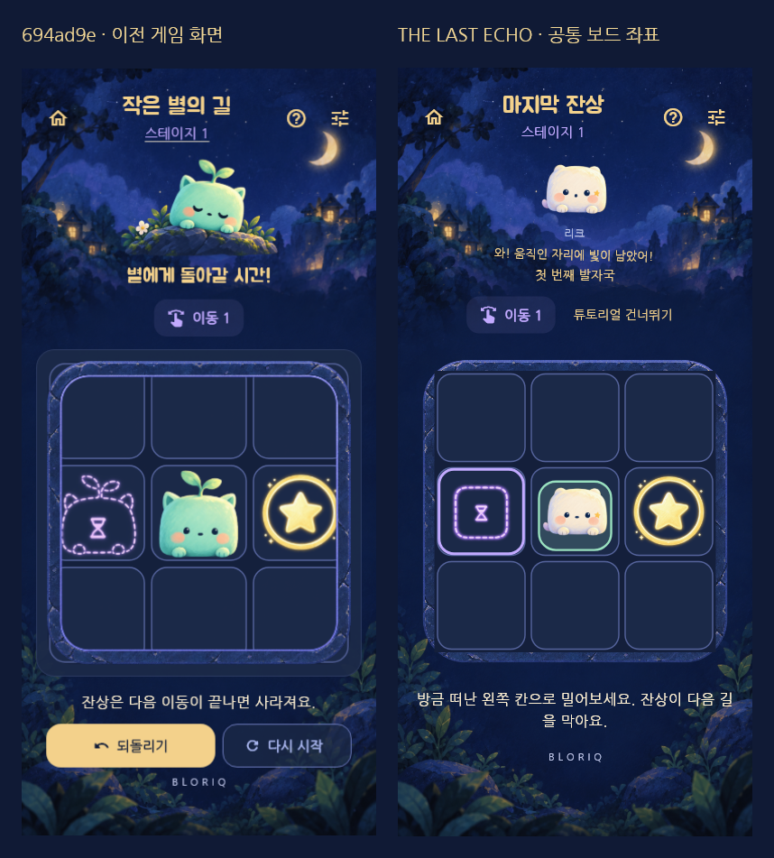

이전 `affe391` 첫 챕터 구현 기록입니다. 최신 전체 시즌은 [달빛 석판 시즌 1](MOONSTONE_SEASON1.md)을 참고하세요.

# BLORIQ — THE LAST ECHO: 첫 챕터 구현·검증

2026-10-30 · 기준 `codex/star-courier-design` / `694ad9e` → 작업 `codex/last-echo-chapter1`.

[실제 화면 4종 테마/언어](last-echo-review.html) · [25종 설정·시즌 줄거리](LAST_ECHO_BIBLE.md) · [첫 5종 아트](../assets/art/last_echo/README.md) · [5명 관찰표](LAST_ECHO_PLAYTEST.md)

## A. 현재 상태 진단

기존 튜토리얼·Preview·Replay·Perfect 평가·Postcard·Daily·7일 기록·챕터·로컬 분석을 재사용했다. 퍼즐 도메인과 25개 활성 배치, 레벨 ID·revision·최단 이동·기믹·별 계산은 변경하지 않았다. 확인되지 않은 맥북 코드를 포함했다고 간주하지 않는다. 이번 작업은 로컬 작업 브랜치에 한정하며 main 병합·원격 푸시·공개 배포는 하지 않았다.

기존 화면은 목표/일반 블록이 모두 친구처럼 보여 역할을 혼동할 여지가 있었다. 새 화면은 리크=크림색 주인공+민트 받침, 일반 블록=얼굴 없는 Blue 룬석, Echo=속 빈 Purple 윤곽, 별문=Gold로 구분한다. 기존 민트 새싹 정령은 첫 수집 친구 모리로 이어진다.

### 정렬 재현 결과

320px 실제 위젯에서 계산한 보드가 **240×240인데 GameWidget은238×240**으로 배치되는 경우를 재현했다. 바깥 `ArcadeSurface`의 1px 테두리가 양쪽 제약을 줄였기 때문이다. 중복 표면을 제거하고 프레임은 판 뒤에, 24px 외부 여백에 둔다. 분리된 계산 자체를 확인 전 원인으로 단정하지 않았다.

`BoardGeometry`가 행·열·DPR 기준 셀 크기, 원점, 셀/타일/스프라이트 영역, 터치 변환, 24% 드래그 임계값을 제공한다. Flutter 배치와 Flame/Preview/입력이 공유한다. Preview도 이동 확정과 같은 축 기준을 쓴다. 화면/DPR 변경은 현재 드래그·Preview만 취소하고 보드·Undo를 유지한다.



## B. 구현 구조

| 영역 | 파일 | 책임 |
|---|---|---|
| 공통 보드 | `lib/game/board_geometry.dart`, `bloriq_game.dart`, `main.dart`, `design/star_art.dart` | 실제 배치·그림·입력의 공통 좌표, 프레임 비가림 |
| 설정 자료 | `assets/story/season1.json`, `lib/story/story_catalog.dart` | KO/EN 시즌·챕터·25종 고정 ID·별문 제목·기억·공개 상태 |
| 저장 | `lib/story/collection_repository.dart`, `progress/progress_repository.dart` | 완료 근거·집합 지급·미확인/확인·동행·실패 재시도·원문 보호 |
| 반응 | `lib/story/narrative_controller.dart`, `companion_view.dart` | 성공한 이동·Echo 차단·Gate·완료에 대한 얼굴·짧은 대사. 이동 판정 없음 |
| 공유 세션 | `lib/app/game_session.dart` | 스토리/도감/진행/오디오를 한 번 로드해 공유 |
| 진입·홈·지도 | `lib/app/app_entry.dart`, `level_picker.dart` | 신규1번 튜토리얼, 재방문 홈, 첫5개 제목·발견 상태와 이후20개 선택 |
| 결과·도감·공유 | `lib/story/discovery_panel.dart`, `spirit_album.dart`, `story_share.dart`, `game/victory_panel.dart`, `postcard/echo_postcard.dart` | 결과 하나에 별·발견·기억·다음, 상세·동행·PNG 공유 |
| 시각·문구 | `assets/art/last_echo/`, `lib/game/block_art.dart`, KO/EN ARB | 실제 첫5종·RIQ 표정·룬석·범용 Echo와 현지화 |

새 production dependency·서버·광고·결제·release 서명 변경은 없다. 퍼즐 `Level`에 이야기 필드를 넣지 않았다.

## C. 실제 플레이·저장 동작

```text
신규 실행 → 실제1번 튜토리얼(이동/차단/출구)
→ 캠페인 완료 저장 → 공개 배정과 대조 → 모리·기억 등록
→ 결과 하나에서 읽기/즉시 넘기기/다음/Replay/Postcard
→ 2~5번의 친구와 기억 → 루나벨의 작은 결말

재방문 → 여정 홈 → 첫 미완료 별문 / 지도 / 도감 / Daily
```

- 재방문 자동 인트로는 제거했다. 기존 4초 무음 인트로는 설정 다시 보기로 보존하며, 게임 보드·Undo를 유지한다.
- 일반 첫 발견 연출은 기존1.45초, 루나벨은 최대2.2초다. 처음부터 건너뛰기를 제공하고 발견 결과의 다음 버튼은 연출 종료를 기다리지 않는다. 모션 줄이기는 정적이다. 배경은 항상 정적이다.
- 모리·포미·도토·루루·루나벨만 실제 공개했다. 각 기억은 결과와 도감에서 볼 수 있다. 5번은 친구들이 버려진 것이 아니라 별문 안에서 보호받으며 잠들어 있었다는 사실만 밝힌다.
- 첫 친구 자동 동행, 도감에서 선택·재실행 복원. 동행/상태 반응은 보드 밖이며 작은 화면에서는 축소한다. 고유 손·날개 관절 애니메이션을 제작했다고 주장하지 않는다.
- 6~25는 계속 선택/플레이 가능하지만 후속 정령은 지급하지 않는다. 숨긴 친구의 이름·기억은 노출하지 않는다. Daily는 ‘오늘의 작은 산책’이며 캠페인/연습과 저장 목적지가 다르다.
- 기존 PNG Postcard를 확장해 소유 친구의 발견 카드·부분/전체 챕터 카드를 만든다. 명시적 공유 버튼을 눌러야 시스템 공유 기능을 호출한다. 영상 내보내기·도전 카드 추가는 없다.

### 저장과 복구

기존 `bloriq.progress.v2` 구조를 유지한다. 성공적으로 읽거나 쓴 완료 스냅샷의 스테이지 ID만 수집 근거다. 완료 횟수를 늘리는 `recordCompletion`과, 횟수를 늘리지 않는 `retrySave`를 구분했다.

`bloriq.collection.v1`은 소유 ID·기억 ID·선택 동행·확인/미확인 발견·복구 요약 확인을 저장한다. 첫 완료는 진행 저장→누락된 공개 친구와 기억의 집합 추가→수집 저장 순서다. 수집 저장 전에 종료되어도 시작 시 같은 완료 기록을 대조해 복구한다. 두 키를 원자적 트랜잭션처럼 다루지 않으며 저장 패키지의 물리적 내구성을 보장하지 않는다.

같은 course2의 과거 revision은 수집에 인정하되 현재 별·완료율은 기존 revision 정책을 유지한다. 더 오래된 `bloriq.progress.v1`의 같은 번호를 섞지 않는다. 기존 완료자는 요약 한 번으로 복구하며 강제 발견 팝업을 연달아 보여 주지 않는다.

손상/미래 schema는 자동 덮어쓰지 않는다. 손상 도감의 명시적 복구는 먼저 원문을 `bloriq.collection.corrupt-backup.v1`에 저장한다. 백업 실패 시 원문을 유지한다. 진행 JSON 손상도 이제 덮어쓰지 않으며 세션 플레이만 가능하다. 해당 진행 원문을 안전하게 복원하는 별도 사용자용 편집 도구는 이번 범위가 아니다.

## D. 실제 검증 결과

Windows / Flutter3.47.8 / Dart3.13.7. Flutter가 PATH에 없어 확인된 SDK의 `bin/*.bat` 절대 경로로 실행했다. 실제 로그는 Git에서 제외한 `build/last-echo-*.log`에 남겼다.

| 명령·검사 | 결과 |
|---|---|
| `flutter pub get`, `flutter gen-l10n` | 실행 완료, dependency/lockfile 변경 없음 |
| `dart format .`, `flutter analyze --no-pub` | 포맷 적용, 정적 분석 문제 없음 |
| `flutter test --no-pub --reporter expanded` | **245개 통과** |
| `python tools/validate_levels.py` | **25/25 해결 가능, JSON 최단 이동과 BFS 일치** |
| `python -m unittest tools.test_hybrid_tools -v` | **5개 통과** |
| `flutter test test/last_echo_capture_test.dart --dart-define=CAPTURE_LAST_ECHO=true` | 일반 검사와 분리한 실제 위젯/Canvas 캡처 통과 |
| `flutter build web --release --no-pub --dart-define=BUILD_TAG=last-echo-chapter1-2026-10-30` | 성공, `build/web`. `--wasm` 앱 실행 검증은 아님 |
| `flutter doctor -v`, `flutter build apk --debug` | 환경 확인/빌드 시도. **Android SDK 없음으로 APK 중단** |
| Android profile·실기기·서명 AAB·사람5명 관찰 | 미실행. 기기/SDK/서명과 참여자 필요 |

화면은 **393×852 · KO/EN × Light/Dark**의 튜토리얼·Echo·차단·첫5종 발견·5번 게임판·홈·지도·도감·기억·Daily·공유 미리보기다. 64장 화면과 보드 비교1장, 실제 공유 데이터의1080px PNG2장으로 총67장이다. 실제 공유 시트·음향 출력·16.7ms 프레임 예산을 측정한 자료는 아니다.

추가 자동 검증:

- 6개 화면 크기(320×568,360×800,393×852,412×915,600×960,852×393) × DPR1/2/3에서 1/6/14/25번 **72개 조합**의 실제 드래그·프레임 여백·크기 일치·resize 후 Preview 취소와 Undo 보존. 직사각형은 별도 geometry/기존 입력 회귀로 검사했다.
- 셀 중심↔터치, 경계 밖 입력, 물리 픽셀 단위 셀 크기·타일/스프라이트 영역 검사.
- 최초 세 조작, 첫5개 실제 solver 해법 드래그, 친구 한 번 지급, 건너뛰기·다시 읽기·동행 복원·5번 재클리어 중복 없음.
- Daily/연습 미지급, 과거 revision 복구·별 분리·구코스 격리, 연출 중 종료의 미확인 상태와 부분 실패 복구, 저장 재시도 완료 횟수 유지.
- 손상 도감 백업 실패/성공, 미래 schema 원문 보호, 직렬 저장 스냅샷·유효 동행 유지.
- 한국어/영어·Light/Dark·320px·200% 글꼴의 도감 상세/동행/닫기, 기존 홈·설정·도움말·그리드 회귀.
- 기존 Echo·Gate·Eraser·Hold·One-way·Goal-only·Undo·Restart·Preview·Replay·Postcard·별 기록·Daily·분석 동의 회귀.

웹 빌드는 CupertinoIcons 폰트에 대한 SDK 경고를 출력했다. 현재 화면의 실제 아이콘은 MaterialIcons이며 추가 폰트 패키지를 도입하지 않았다. 정적 분석과 기본 웹 release 빌드는 통과했으며, 브라우저 접근 거절 뒤 우회 재시도하지 않았다.

## E. 실행과 남은 확인

```powershell
flutter pub get
flutter gen-l10n
flutter run -d chrome
# Android SDK/JDK와 USB 디버깅 기기가 준비된 후
flutter devices
flutter run --profile -d YOUR_DEVICE_ID
```

현재 PC의 SDK는 `C:\Users\user\.codex\visualizations\2026\10\28\01a17fdf-a558-7601-b474-70371016fa0d\flutter-sdk\bin`이다. 다른 PC는 자신의 Flutter SDK를 PATH에 추가한다. 캡처 폰트는 앱에 포함된 Jua/NanumGothic을 사용하므로 별도 OS 폰트 경로가 필요 없다.

**첫 챕터 코드·자동 검증은 완료했지만 모바일 출시 준비 완료는 아니다.** 다음은 Android 실기기의 터치·오프라인·BGM/무음·종료/복귀·저장 복구·profile 프레임 확인과 [5명 관찰](LAST_ECHO_PLAYTEST.md)이다. 사용자 관찰에서 규칙/정령 구분이나 다음 별문 동기가 부족하면 아트·보상을 늘리기 전에 수정한다. 이후20종 아트/수집과 광고 SDK·release 서명·스토어 출시는 별도 범위다. D1/D7·Crash-free users 실적은 측정하지 않았다.
